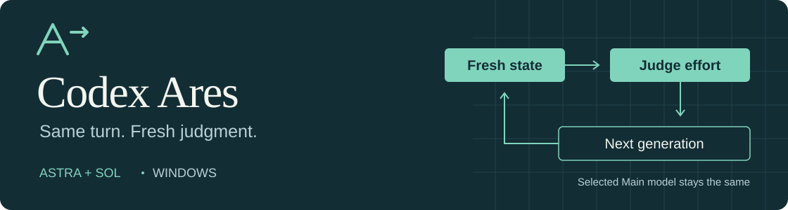

# Codex Ares for Windows

**Codex 0.166.0-alpha.5.1 source preview (`f602eec3…`), tested CLI `456a494b…`, Desktop 26.1027.3384.0 (display 26.1027.30824).** Local source/build/static-contract checks passed, and a later manual taskbar launch was observed with the same native hash. Dedicated current-candidate GUI effort, Stop/recovery and compaction/resume acceptance, provider qualification and fresh-PC setup remain unverified. Automatic restart failed in a separate local workflow; that helper is not distributed in this source preview. See [validation](docs/validation.md).

<p align="center"></p>

[English](README.md) · [한국어](README.ko.md) · [日本語](README.ja.md) · [简体中文](README.zh-CN.md)

Ares keeps your selected Astra/Sol/Terra Main model. Before each eligible generation, an independent GPT-6 Luna/High evaluator recommends medium/high/xhigh/max from the supported catalog. Ordinary Luna and subagents do not acquire Ares control. Recommendations belong to one owner, thread, turn and generation. Manual settings take ownership; a late automatic decision cannot override them. Only the dedicated Ares child environment supplies the step-switching default; explicit configuration and managed opt-outs still win. The launcher checks the effective prerequisites before Desktop starts.

On evaluator failure or abstention, native fallback retains the last confirmed xhigh/max only when it still matches the current effort and supported catalog; otherwise it selects supported High. Invalid catalog metadata or no valid fallback disables adaptation. Evaluator failures use the existing 30/60/at-most-120-second cooldown. This does not always restore an arbitrary user baseline. A transmitted effort or completed response does not establish the provider's internal computation or answer quality.

## Build and inspect

Use the exact locked source. Windows x64, Node 22+/npm, Git, Rust 1.99.1 and Visual Studio x64 C++ tools are required. The [lock](patches/codex/upstream.lock.json) pins official upstream `f79b26ccbb3116b052544666a181012fb45dc49b`, the cumulative patch and dependency inputs. The [build guide](docs/build.md) covers restoration, build resumption, V8, SQL checksum bytes and local protocol verification.

```powershell
npm run setup
.\scripts\doctor.ps1
.\scripts\start.ps1 -PreflightOnly
```

The build record binds actual hashes of CLI and all four companions to the verified source, lock, toolchain and successful stages. Bundling rejects missing, stale, failed or mismatched evidence. It preserves existing bundles and rechecks copied bytes. These are local consistency checks, not signed-build or reproducible-binary claims.

Doctor may pass without a bundle; inspect its `bundle` result. A usable candidate also needs exact local protocol proof against the actual registered Desktop. Missing or mismatched proof remains a startup rejection. Setup and preflight do not launch Desktop or qualify GUI/provider behavior. Follow [update, recovery and removal](docs/build.md#update-recovery-and-removal) and quit existing work normally before an accepted activation.

## Evidence and limits

For Desktop 26.1027.3384.0, the recorded fresh local proof covers stable320/experimental466 schemas with the reviewed Ares projection. CLI and four companions were built from the same fixed source. Default npm test passed244/0/0; bundle, Doctor and1561-input preflight passed without Desktop activation or model calls. SDK122, protocol317 plus separately executed generators, native-focused180, launch defaults17, startup/model63+6 and mock app-server7 cover separate, overlapping scopes; they are not a product-wide total or GUI/provider acceptance.

Historical source341 evidence covers Desktop 26.1023.6123.0/native 0.165.0-alpha.1.2, stable320/experimental460, default `npm test`236 without skips and same-bundle SDK runtime46 using mock transport. Config17/default-path RPC7, launcher startup18 and actual effective-config probes4 belong to that source and their separate scopes. Other native/SDK regressions are reused only for unchanged areas. These historical counts are not executions on sourcef602eec or one product-wide total. See [validation](docs/validation.md) and [compatibility](docs/compatibility.md).

The predecessor `88886d7…` did start the GUI/backend and attempt one request, but step switching was disabled and no native Ares trace or Luna evidence was observed. The user clicked Stop and the turn was interrupted; native cancellation terminal proof was not established. That failed diagnostic does not qualify the corrected candidate. Earlier0.163 GUI Medium, restart, compaction/resume, Stop and recovery observations remain historical. The historical0.163 cancelled request's 452ms elapsed was not measured UI-click latency. The original PowerShell error cause and historical launch-manifest hash remain UNKNOWN. Small quality/usage samples do not establish general equivalence, savings or long-term stability. The full native patch has not completed independent review, and no full independent native security audit is claimed.

[Changes](CHANGELOG.md) · [Architecture](docs/architecture.md) · [Privacy](docs/privacy.md) · [Patch map](patches/codex/PATCH_MAP.md)

Accepted `native_task_delivery` requires host provenance and matching receiver identity. Isolated RPC evidence does not establish its ordinary GUI generation path, which remains unobserved.

Most downstream changes were produced and revised with OpenAI Codex. Derived from [Astra-Ares](https://github.com/miuuyy/Astra-Ares) and [OpenAI Codex](https://github.com/openai/codex); not an official OpenAI product. [LICENSE](LICENSE) and [third-party notices](THIRD_PARTY_NOTICES.md) preserve the relevant rights. This source preview excludes executables, toolchains, dependency trees, authentication, databases and private runtime evidence. Version `0.1.0-preview.4` is a source-only Technical Preview. The Release identifies its exact published commit, CI result and source-asset checksums.
