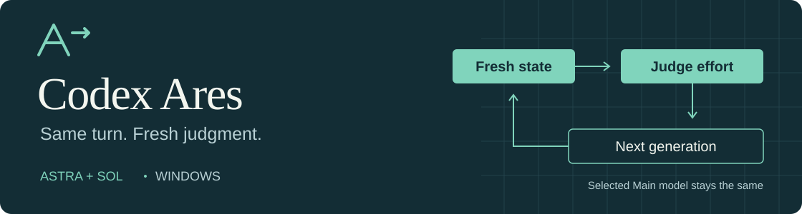

# Codex Ares for Windows

**Codex 0.167.0-alpha.4.1 source preview (`0.1.0-preview.5`) for exact Desktop 26.1106.6628.0.** This source-only Technical Preview has complete source-restoration and local regression results. Separate private operating checks of the same native inputs passed automatic restart and repeated authenticated service initialization. These results do not establish public-layout GUI/provider or fresh-PC acceptance. [Validation](docs/validation.md) separates the scopes and the prepublication CI snapshot. No installed runtime or private acceptance data is distributed.

<p align="center"></p>

[English](README.md) · [한국어](README.ko.md) · [日本語](README.ja.md) · [简体中文](README.zh-CN.md)

Ares keeps the selected Astra/Sol/Terra Main model. Before an eligible generation, an independent GPT-6 Luna/High evaluator recommends a supported medium/high/xhigh/max effort. Ordinary Luna and subagents do not acquire Ares control. Ownership is bound to the thread, turn and generation; an accepted native current-turn manual update takes precedence over late automatic decisions. This does not establish current Desktop GUI active-turn effort controls. Evaluator failure uses the existing supported fallback and cooldown; it does not always restore an arbitrary baseline or establish provider-internal computation, quality or savings.

## Build and inspect

The [public lock](patches/codex/upstream.lock.json) pins official upstream `d2c035639366e0bf2c316aa2065c24aabc12bcdc`, its archive, cumulative Ares patch and full source manifests. The patch changes 199 paths (178 modified, 21 added), including 78 deployed CRLF SQL files. The reconstructed source has 9,930 regular files and one separately checked materialized link. The [build guide](docs/build.md) specifies Windows x64, Node22+/npm, Rust1.99.1, Visual Studio tools, V8 inputs and the supported commands.

```powershell
npm run setup
.\scripts\doctor.ps1
.\scripts\start.ps1 -PreflightOnly
```

A new local build must bind CLI and four companions to its own source/lock/toolchain record, create a bundle, and obtain fresh exact-package protocol proof. Doctor with `bundle:not_built` is a source-only check. Preflight is separate from activation. No adjacent Desktop or companion version is admitted by the exact version guard. Follow the [update/recovery procedure](docs/build.md#update-recovery-and-removal) and finish existing work before any accepted activation.

## Evidence and limits

[Validation](docs/validation.md) records complete content/mode/tree restoration, public mock/static regressions and local build/protocol checks separately from private same-native operation. The automatic normal-shutdown/capture/verify/start sequence passed, followed by two successful authenticated service initializations and ordinary shell/builtin-patch checks. Exact-published-commit CI was NOT_RUN at the dated prepublication snapshot; the Release identifies its actual commit and CI result. General GUI native_task_delivery, fresh-PC installation, physical Windows symlink creation and full independent security/binary-redistribution audits remain unverified. Earlier preview.1–4 results retain their own source identities and do not qualify these bytes.

Detailed context tracing is opt-in for one exact thread. Provider requests use existing configured authentication/routing; the independent evaluator has no tools or MCP. [Privacy](docs/privacy.md) explains traffic and local diagnostics. Source publication excludes executables, dependencies, auth, databases, conversations, runtime logs and recovery sets. Private Git history is not imported. [LICENSE](LICENSE), [third-party notices](THIRD_PARTY_NOTICES.md), [patch map](patches/codex/PATCH_MAP.md) and [changes](CHANGELOG.md) retain the relevant boundaries. Most downstream work was produced with OpenAI Codex; this is not an official OpenAI product.
